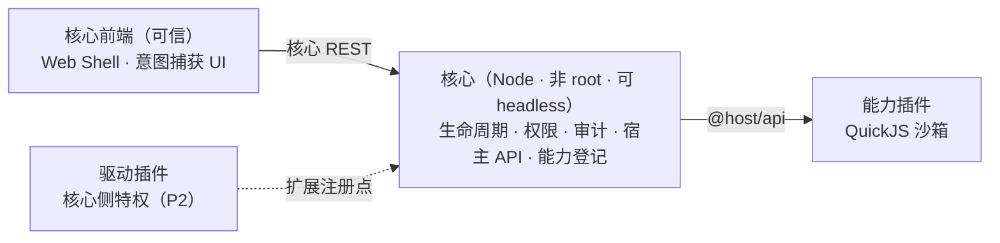

<!-- markdownlint-disable MD033 -->

<div align="center">

<picture>
  <source media="(prefers-color-scheme: dark)" srcset="assets/logo-on-dark.svg">
  
</picture>

# ServerPluginCore

**插件化的服务器管理核心** —— 本体最小，能力全插件化

[](https://github.com/xfy2412/ServerPluginCore)
[](https://github.com/xfy2412/ServerPluginCore/releases)
[](LICENSE)
[](https://github.com/xfy2412/ServerPluginCore/pulls)


</div>

> **项目状态**：**P1.5 已落地** —— 插件装载器、生命周期、权限判定、审计与 CLI 管理面均可运行（`pnpm test` 186 例全绿）；**尚无 Web 界面**（P3 设计中），构建层与事件总线（P2）待开工。详见 [开发路线](docs/ROADMAP.md)。

## 这是什么

ServerPluginCore 是一个**插件化的服务器管理平台核心**。核心只做四件事——**认证、权限、审计、插件生命周期**；其余能力（文件管理、终端、Docker、数据库、监控……）全部由插件提供，按需安装、按需加载。

它的目标场景是"要长期自己维护服务器"的人：核心不预置你可能永远用不到的功能，也不会为了它们占用界面和资源。不需要 Web 界面时，核心可以完全 **headless** 运行，一切管理回到命令行。

设计上把插件当作**不可信代码**：插件运行在 QuickJS 沙箱内，拿不到 `process`、`require`、网络，**唯一出口是宿主审核过的 `@host/api`**。因此安全边界落在"接口审查"上，而不是"事后隔离"。

## 能做什么（现状）

| 能力 | 状态 | 说明 |
|---|---|---|
| 插件装载与生命周期 | ✅ | `init`/`start`/`stop` 契约、唯一状态机、能力登记（可精确撤销）、安装记录、**失败隔离**（单插件失败不影响核心与其它插件） |
| 插件依赖图 | ✅ | 依赖必须已装载；装载按**拓扑序**；**环检测**；**反向保护**（被依赖时不许卸载/禁用） |
| 四层限额 | ✅ | CPU 中断（不可被 `try/catch` 吞掉）/ 内存 / 栈 / 宿主 API 自带超时 |
| 权限判定与审计 | ✅ | 权限注册表 + 三态判定；每次调用落审计，只记机器可读的码与参数摘要 |
| 宿主 API | ✅ | `exec`（**模板制，无自由命令**）/ `fs` / `kv` / `timers` / `events` / `lifecycle` |
| CLI 管理面 | ✅ | `plugin install / enable / disable / reload / uninstall / status / list / grant / revoke` |
| 构建与打包 | ⏳ P2 | 依赖三层 + esbuild bundle + 元数据生成 |
| 事件总线 + 驱动扩展点 | ⏳ P2 | 事务裁决语义；驱动插件注册权限节点与 API 端点 |
| Web 界面与主题系统 | ⏳ P3 | Web Shell + 意图捕获 UI + 声明式 / iframe 插件容器 |
| 市场与签名 | ⏳ P4 | 核心库已落地（规范化签名 / keyring / 链式轮换），安装流与市场服务待做 |

## 快速开始

需要 **Node.js 20+** 与 **pnpm**（项目用 `patchedDependencies` 给 quickjs-emscripten 打了补丁，pnpm 是硬要求）。

```bash
pnpm install
pnpm spike              # 真实链路：写安装记录 → 装载 → init/start → stop → 卸载
pnpm test               # 186 例
pnpm verify:sandbox     # 验证 QuickJS 补丁有效（8/8）
```

`pnpm spike` 的典型输出：

```text
[spc] installing @xfy2412/sample from plugin/sample ...
[@xfy2412/sample] init: dataDir=/…/.spc/data/plugins/xfy2412__sample
[@xfy2412/sample] core=0.0.0 api=1
[@xfy2412/sample] record=hello #1 bytes=9
[@xfy2412/sample] files=[kv.json(file),started.log(file)]
[@xfy2412/sample] git: git version 2.x
[@xfy2412/sample] started (heartbeat every 30s)
[spc] plugins=1
  · @xfy2412/sample@0.0.1 [running] enabled=true reserved=true grants=[exec.template.git.version]
[spc] stopping all plugins ...
[spc] done.
```

首次运行会把内置样板插件装进状态目录（`SPC_STATE_DIR`，默认 `<仓库>/.spc`）。它刻意演示了两条**不同的授权路径**：

- `fs` / `kv` / `timers` / `events` / `lifecycle` → `scope=self`，**声明即可用**；
- `exec.template.git.version` → `scope=host`，**必须管理员逐点授予**。

管理面需要一个守护进程：

```bash
pnpm daemon                    # 起核心（127.0.0.1，ed25519 握手鉴权）
pnpm spc plugin list           # 另一个终端
pnpm spc plugin status @xfy2412/sample
```

## 插件类型

| 类型 | 运行位置 | 职责 | 前端 |
|---|---|---|---|
| **能力插件** `ability` | QuickJS **沙箱** | 挂载管理页面并提供管理能力；只调 `@host/api` | `declarative`（核心渲染组件树）或 `iframe`（沙箱隔离） |
| **驱动插件** `driver` | **核心端**（特权） | 实现 Docker / 数据库 / SSH 等协议能力，注册权限节点 + API 端点给沙箱，并自行鉴权 | 独立安装界面 + 最高强度提示 |
| **协作插件** `hook` | 设计中 | 通过钩子参与核心事件生命周期并干预／修改 | 待 ADR 定稿 |
| **主题包** `theme` | 核心前端 | 声明式设计令牌 + 资源 + 受限样式（换肤／密度／图标），**无 JS、无沙箱** | 核心渲染 |

## 架构



三条边界值得记住：

- **插件与 OS 之间**：只有 `@host/api` 一条通道，`exec` 只接受注册过的模板（没有自由命令）；
- **插件与用户资源之间**：用户选中的资源由核心前端捕获意图后签发**短期凭证**（`grantId`），插件只能凭它调用，不能自己"解释"意图；
- **核心与插件之间**：核心自己做得到的操作（删文件、开会话、重启服务）**不经过插件**，由核心前端确认后直接执行。

## 文档

**契约与设计**（先看这两份就够动手）：

| 文档 | 内容 |
|---|---|
| [宿主 API 契约](docs/api-contract.md) | 方法组与权限点、判定链、审计字段、manifest schema 2 |
| [插件生命周期与装载器](docs/plugin-lifecycle-design.md) | 装载契约、状态机、四层限额、能力登记、安装记录、CLI 面<br/>**P1.5 已落地**，§14 是落地记录与 13 条实现偏差 |

**架构决策（ADR）**：

| 文档 | 决策 |
|---|---|
| [ADR-001](docs/ADR-001-plugin-trust-model.md) | 信任模型：零环境权力 + 市场签名（来源只管更新渠道，不参与权限判定） |
| [ADR-002](docs/ADR-002-core-and-runtime.md) | 核心与运行时选型：Node 核心 + QuickJS 沙箱 |
| [ADR-003](docs/ADR-003-market-openness.md) | 市场开源：代码全开、密钥全闭 |
| [ADR-004](docs/ADR-004-os-boundary.md) | OS 底线：非 root + 资源限制 |
| [ADR-005](docs/ADR-005-plugin-sandbox-and-plugin-types.md) | 沙箱机制与四类插件 |

**专题**：

| 文档 | 内容 |
|---|---|
| [意图捕获与双通道权限](docs/intent-capture.md) | 用户意图的信任根、grantId、声明式/iframe 前端、CSP 零出网、**默认安全边界** |
| [exec 沙箱与模板注册制](docs/exec-sandbox-design.md) | 模板来源与命名空间、双层安全模型、E1–E10 静态校验 |
| [构建层设计](docs/build-layer-design.md) | 打包流水线：esbuild 配置决策（**实测依据**）、依赖闭包与 tier 判定、内建校验两道闸、产物元数据（P2） |
| [接口审计：exec + fs](docs/interface-audit-exec-fs.md) | 危险接口的威胁建模清单 |
| [签名与源设计](docs/plugin-signature-design.md) | 元数据规范化签名、keyring、链式密钥轮换 |
| [manifest 设计](docs/manifest-design.md) | 清单字段与权限声明（Android 权限系统参考） |
| [官方模块仿真](docs/module-emulation-design.md) | 让插件按 Node 原生写法编写（P2） |
| [市场授权设计](docs/market-license-design.md) | 永久授权 + 维护窗口（P4） |
| [管理通道](docs/management-channel.md) | CLI ↔ daemon 的握手与鉴权 |
| [开发路线](docs/ROADMAP.md) | P0–P5 阶段规划与风险清单 |

**记录**：[Spike：QuickJS 沙箱可行性验证](docs/spike-01-quickjs-sandbox.md)（含上游 bug quickjs-emscripten#261 的排查与 pnpm 补丁）

## 参与开发

```bash
pnpm test          # 全量测试（node:test + tsx）
pnpm typecheck     # tsc --noEmit
pnpm spike         # 端到端跑一遍装载链路
```

目录结构：

| 路径 | 内容 |
|---|---|
| `core/` | 核心：沙箱宿主、宿主 API、权限、审计、生命周期、CLI/HTTP |
| `core/plugin/` | 装载器与状态机（`loader` / `manager` / `records` / `capabilities` / `limits` / `config`） |
| `sdk/` | manifest JSON Schema、类型声明（`@host/api`、`@spc/sdk`）、校验器 |
| `plugin/sample/` | 样板插件（演示 ctx、数据目录、kv、定时器与 exec 模板） |
| `docs/` | 契约、ADR 与设计文档 |

**两条硬规矩**：

1. **错误码、权限点、契约字段只增不改**——它们是契约，改名等于破坏已发布的插件（[api-contract §2](docs/api-contract.md)）；
2. **文档必须标注落地状态**——设计稿与已实现的东西要能一眼分清，避免"照着文档写却发现没实现"。

## 开发路线

| 阶段 | 内容 | 状态 |
|---|---|---|
| P0 | 宿主 API 契约定稿（exec/fs/kv/timers + 权限注册表 + manifest schema） | 已完成 |
| P1 | 纵向切片：Node 核心 + QuickJS 沙箱 + exec/fs 接口审计 | 已完成 |
| **P1.5** | **插件生命周期与装载器**：装载契约 / 状态机 / 四层限额 / 能力登记 / 安装记录 / CLI 全命令面 | **已落地** |
| P2 | 构建层与依赖三层 + 事件总线 + 驱动插件扩展点 + 权限档位 | 待开工 |
| P3 | 核心 Web Shell + 主题系统 + 插件前端容器 | 设计中（接口已定） |
| P4 | 市场签名与源管理 + 插件市场 | 核心库已提前落地 |
| P5 | 核心插件集 + 加固 + v1.0 发布 | 待定 |

## 许可证

[MIT](LICENSE)

---

*受 [DeepSeek Harness](https://github.com/deepseek-ai/deepseek-harness) 的插件化哲学启发；安全模型参考了 Velocity / Paper / AstrBot 等开源项目的权限设计经验，命令执行模块参考了 MCSManager 的设计经验——在此对全体开源项目贡献者致谢。*

*Author: [xfy2412](https://github.com/xfy2412) · 本项目由 AI 协助开发*
