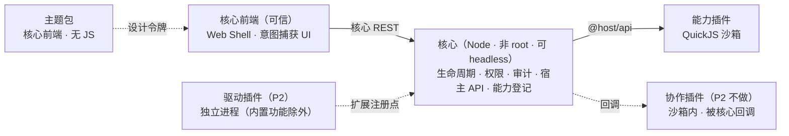

<!-- markdownlint-disable MD033 -->

<div align="center">

<picture>
  <source media="(prefers-color-scheme: dark)" srcset="assets/logo-on-dark.svg">
  
</picture>

# ServerPluginCore

**插件化的服务器管理核心** —— 本体最小，能力全插件化

[](https://github.com/xfyweb/ServerPluginCore)
[](https://github.com/xfyweb/ServerPluginCore/releases)
[](LICENSE)
[](https://github.com/xfyweb/ServerPluginCore/pulls)


</div>

> **项目状态**：核心、管理命令行（`spc`）与作者工具链（`spcdev`）已可用，可以装插件、跑插件；**Web 界面在设计中**。未落地的部分见[当前进度](#当前进度)与[路线图](docs/ROADMAP.md)。

## 这是什么

ServerPluginCore 是一个**插件化的服务器管理平台核心**。本体只提供四件事——**认证、权限、审计、插件生命周期**；文件管理、终端、Docker、数据库、监控等能力全部由插件提供，按需安装、按需加载。

它面向需要长期自己维护服务器的人：本体不预置用不到的功能，也不为它们占用界面和资源；不需要 Web 界面时，核心可以完全 **headless** 运行，管理回到命令行。

插件默认按**不可信代码**对待：运行在 QuickJS（WASM）沙箱里，拿不到 `process`、`require` 和网络，只能调用宿主审核过的 [`@host/api`](docs/api-contract.md)。安全边界因此落在**接口审查**上，而不是事后隔离。

## 特性

- **插件沙箱** —— 纯 JS 插件跑在 QuickJS（WASM）里，受四层限额约束（CPU 中断、内存、栈、宿主 API 超时）；单个插件崩溃或超时不影响本体与其它插件。
- **最小权限** —— 权限注册表 + 三态判定，权限点要在清单里逐条写明理由；`exec` 只接受注册过的命令模板，**没有自由命令**。
- **调用可审计** —— 每次宿主 API 调用都落审计，只记录机器可读的码与参数摘要。
- **插件生命周期** —— `init` / `start` / `stop` 契约、唯一状态机、依赖按拓扑序装载、环检测、被依赖时不许卸载。
- **无头可用** —— 关掉 Web 服务，插件管理、授权、审计全部回到 `spc` 命令行。
- **作者工具链** —— `spcdev new` / `check` / `build` 全程本地运行，不连守护进程。
- **构建期把关** —— 未登记的 Node 内建模块与原生模块在**构建期**报错，不等到运行期才发现。
- **Node 习惯可用** —— 25 个常用 Node 模块可在沙箱内按原生写法使用（`fs` / `path` / `stream` / `crypto` / `zlib` / `url` 等），行为对齐 Node，对齐不了的明确报错。

## 快速开始

需要 **Node.js 24.20.0** 与 **pnpm**（本体按这条基线开发与测试，更低版本未验证；quickjs-emscripten 通过 `patchedDependencies` 打了补丁，pnpm 是硬要求）。

```bash
pnpm install
pnpm spike              # 真实链路：写安装记录 → 装载 → init/start → stop → 卸载
pnpm test               # 1188 例（Windows 1182 过 / 6 平台跳过；Linux 1186 过 / 2 跳过）
pnpm verify:sandbox     # 验证 QuickJS 补丁有效（8/8）
```

`pnpm spike` 的典型输出：

```text
[spc] installing @xfy2412/hello from plugin/hello ...
[@xfy2412/hello] init: dataDir=/…/.spc/data/plugins/xfy2412__hello
[@xfy2412/hello] core=0.0.0 api=1
[@xfy2412/hello] record=hello #1 bytes=9
[@xfy2412/hello] files=[kv.json(file),started.log(file)]
[@xfy2412/hello] git: git version 2.x
[@xfy2412/hello] started (heartbeat every 30s)
[spc] plugins=1
  · @xfy2412/hello@0.0.1 [running] enabled=true grants=[exec.template.git.version] caps=[route:/hello,endpoint:/api/hello/status,event:hello.heartbeat]
[spc] stopping all plugins ...
[spc] done.
```

首次运行会把内置样板插件装进状态目录（`SPC_STATE_DIR`，默认 `<仓库>/.spc`）。它演示了两条不同的授权路径：

- `fs` / `kv` / `timers` / `events` / `lifecycle` → `scope=self`，**声明即可用**；
- `exec.template.git.version` → `scope=host`，**需要管理员逐点授予**。

管理面需要一个守护进程：

```bash
pnpm daemon                    # 起核心（127.0.0.1，ed25519 握手鉴权）
pnpm spc plugin list           # 另一个终端
pnpm spc plugin status @xfy2412/hello
pnpm spc daemon stop           # 停止核心
```

> 停机优先用 `pnpm spc daemon stop`（走 HTTP，跨平台一致）。前台运行时 `Ctrl+C` 走同一条路径，连按两次为强制退出（退出码 130）；停机超时默认 10s，可用 `SPC_SHUTDOWN_TIMEOUT_MS` 覆盖。

## 插件类型

本体只做四件事，扩展点按**插件需要什么样的运行环境**分成四类：

| 类型 | 运行位置 | 用途 | 状态 |
|---|---|---|---|
| **能力插件** `ability` | QuickJS 沙箱 | 挂管理页面、提供管理能力（文件管理、终端、监控……） | ✅ 可用 |
| **驱动插件** `driver` | 独立进程 | 实现 Docker / 数据库 / SSH 等协议能力，向沙箱插件注册 API | ❌ 未开工 |
| **协作插件** `hook` | 沙箱内（由本体回调） | 在本体的决策点上出意见，如 SSO 登录裁决 | ❌ P2 不做 |
| **主题包** `theme` | 本体前端 | 声明式主题令牌与资源（换肤／密度／图标），无 JS | ✅ 可装载（前端渲染属 P3） |

**能力插件**是主要形态：纯 JS，跑在沙箱里，只通过 `@host/api` 做事，因此可以放心安装。它提供的前端有两种形态——`declarative`（清单里声明组件树，本体渲染，插件代码不执行）或 `iframe`（隔离 iframe + CSP 零出网，经 `MessageChannel` 代理）。

**驱动插件**需要真实系统能力（原生模块、网络、子进程），沙箱给不了，因此一律跑在**独立进程**里（唯一例外是随本体一起发布的内置功能）。它能做的事多得多，所以适合安装你信得过的来源；每个驱动带一份按平台分列的运行配方——Linux 用专用 uid、mount namespace 白名单、Landlock 与资源限额，Windows 用受限令牌 / Job Object。

想自己写一个？仓库里有两个样例可以从头读：`plugin/counter/`（40 行，只用 `fs` 读写自己的数据目录）与 `plugin/hello/`（综合示例，把宿主 API 走一遍）。

## 当前进度

上面「[特性](#特性)」一节是已经能用的部分。还没做的主要有：

| 事项 | 阶段 |
|---|---|
| 事件面：插件发布事实、声明过关系的插件收到、本体只搬运 | P2 |
| 驱动插件线（注册协议、独立进程宿主与平台配方） | P2 |
| `exec.spawn` 命令任务模型 + 进程管理器 | P2 |
| `.spc` 容器打包（`spcdev pack`）+ 托管副本安装 + `spcdev dev` | P2 |
| Web 界面（Web Shell + 意图捕获 UI + 插件前端容器）与主题渲染 | P3 |
| 市场服务与有源安装流（签名核心库已提前落地） | P4 |
| 日常管理能力的薄适配器（monitor / files / nginx / backup） | P5 |

完整的阶段划分、风险清单与实现偏差记录见 [`docs/ROADMAP.md`](docs/ROADMAP.md) 与 [`docs/plugin-lifecycle-design.md`](docs/plugin-lifecycle-design.md)。

## 架构



- 插件只通过 `@host/api` 与本体通信，`exec` 只接受注册过的模板；
- 访问用户资源由本体前端捕获意图并签发**短期凭证**（`grantId`），插件不能自行解释意图；
- 本体自己就能做的操作（删文件、开会话、重启服务）不经过插件；
- 驱动插件在独立进程里以平台配方限权——这是**限权与崩溃隔离**，不是沙箱。

## 文档

**契约与设计**（动手前先看这几份）：

| 文档 | 内容 |
|---|---|
| [宿主 API 契约](docs/api-contract.md) | 方法组与权限点、判定链、审计字段、manifest schema 2 |
| [插件生命周期与装载器](docs/plugin-lifecycle-design.md) | 装载契约、状态机、四层限额、能力登记、安装记录、CLI 面（§14 是落地记录与实现偏差） |
| [构建层设计](docs/build-layer-design.md) + [实测证据](docs/build-layer-evidence.md) | 打包流水线：依赖闭包、内建校验两道闸、产物事实写清单、作者签名信封 |
| [命令行契约](docs/cli-contract.md) | `spc` / `spcdev` 两个命令的受众、退出码、TTY 与输出通道 |

**架构决策（ADR）**：

| 文档 | 决策 |
|---|---|
| [ADR-001](docs/ADR-001-plugin-trust-model.md) | 信任模型：零环境权力 + 市场签名（来源只管更新渠道，不参与权限判定） |
| [ADR-002](docs/ADR-002-core-and-runtime.md) | 核心与运行时选型：Node 核心 + QuickJS 沙箱 |
| [ADR-003](docs/ADR-003-market-openness.md) | 市场开源：代码全开、密钥全闭 |
| [ADR-004](docs/ADR-004-os-boundary.md) | OS 底线：非 root + 资源限制 |
| [ADR-005](docs/ADR-005-plugin-sandbox-and-plugin-types.md) | 沙箱机制与四类插件（含驱动插件的运行位置） |

**专题**：

| 文档 | 内容 |
|---|---|
| [意图捕获与双通道权限](docs/intent-capture.md) | 用户意图的信任根、grantId、声明式/iframe 前端、CSP 零出网 |
| [exec 沙箱与模板注册制](docs/exec-sandbox-design.md) | 模板来源与命名空间、双层安全模型、E1–E10 静态校验 |
| [事件面与协作插件](docs/events-and-hooks-design.md) | 事件授权模型、本体只搬运、钩子链为何 P2 不做 |
| [官方模块仿真](docs/module-emulation-design.md) | 让插件按 Node 原生写法编写（含 §14 实测坑清单） |
| [签名与源设计](docs/plugin-signature-design.md) | 元数据规范化签名、keyring、链式密钥轮换 |
| [manifest 设计](docs/manifest-design.md) | 清单字段与权限声明（参考 Android 权限系统） |
| [管理通道](docs/management-channel.md) | CLI ↔ daemon 的握手与鉴权 |
| [特权执行器](docs/privilege-gate.md) | 非 root 之下需要 root 动作时怎么办（P5） |
| [接口审计：exec + fs](docs/interface-audit-exec-fs.md) | 危险接口的威胁建模清单 |
| [市场授权设计](docs/market-license-design.md) | 永久授权 + 维护窗口（P4） |
| [开发路线](docs/ROADMAP.md) | P0–P5 阶段规划、风险清单、明确不做的事 |

**记录**：[Spike：QuickJS 沙箱可行性验证](docs/spike-01-quickjs-sandbox.md)（含上游 bug quickjs-emscripten#261 的排查与 pnpm 补丁）

## 参与开发

```bash
pnpm test          # 全量测试（node:test + tsx）
pnpm typecheck     # tsc --noEmit
pnpm spike         # 端到端跑一遍装载链路
```

目录结构：

| 路径 | 内容 |
|---|---|
| `core/` | 本体：沙箱宿主、宿主 API、权限、审计、生命周期、CLI/HTTP |
| `core/plugin/` | 装载器与状态机（`loader` / `manager` / `records` / `capabilities` / `limits` / `config`） |
| `core/sandbox-modules/` | 被仿真的 Node 模块（常量与错误文案是生成物，改表要走 `tools/truth/` 的生成链） |
| `build/` | 构建层，即 `spcdev` 的实现：工作区发现、作者密钥、脚手架、权限点对账、打包与签名 |
| `sdk/` | manifest JSON Schema、类型声明（`@host/api`、`@spc/sdk`）、校验器 |
| `plugin/` | 插件开发工作区，一个插件一个目录；`hello/` 与 `counter/` 是随本体分发的示例 |
| `tools/` | 取证工具（esbuild 行为矩阵、构建闸探针、依赖面实测），**不参与 `pnpm test`**，见 `tools/README.md` |
| `docs/` | 契约、ADR 与设计文档 |

两条约定：

1. **错误码、权限点、契约字段只增不改**——它们是契约，改名等于破坏已发布的插件；
2. **文档必须标注落地状态**——设计稿与已实现的东西要能一眼分清。

## 鸣谢

> **注**：本部分仅表示本项目参考了以下项目**按各自协议开放的源代码**，**不代表取得任何一方的背书、合作或授权**；部分素材按其来源要求进行声明，明细见 [`assets/ack/SOURCES.md`](assets/ack/SOURCES.md)。如有不妥，欢迎提 issue 或 PR，我们会立即调整。

**起步之源** —— 本项目的起步直接源于它

<p align="center">
  <a href="https://github.com/deepseek-ai/deepseek-harness" title="DeepSeek Harness"></a>
</p>

**基础设施**

<p align="center">
  <a href="https://nodejs.org/" title="Node.js"></a>
  &nbsp;&nbsp;&nbsp;&nbsp;
  <a href="https://pnpm.io/" title="pnpm"></a>
  &nbsp;&nbsp;&nbsp;&nbsp;
  <a href="https://esbuild.github.io/" title="esbuild"></a>
  &nbsp;&nbsp;&nbsp;&nbsp;
  <a href="https://bellard.org/quickjs/" title="QuickJS"><b>QuickJS</b></a>
</p>

**核心安全与模块参考**

<p align="center">
  <a href="https://www.kernel.org/" title="Linux"></a>
  &nbsp;&nbsp;&nbsp;&nbsp;
  <a href="https://www.chromium.org/" title="Chromium"></a>
  &nbsp;&nbsp;&nbsp;&nbsp;
  <a href="https://github.com/MCSManager/MCSManager" title="MCSManager"></a>
</p>

**泛式插件系统参考**

<p align="center">
  <a href="https://velocitypowered.com/" title="Velocity"><picture><source media="(prefers-color-scheme: dark)" srcset="assets/ack/velocity-white.png"></picture></a>
  &nbsp;&nbsp;&nbsp;&nbsp;
  <a href="https://papermc.io/" title="Paper"></a>
  &nbsp;&nbsp;&nbsp;&nbsp;
  <a href="https://github.com/AstrBotDevs/AstrBot" title="AstrBot"></a>
  &nbsp;&nbsp;&nbsp;&nbsp;
  <a href="https://github.com/ClassIsland/ClassIsland" title="ClassIsland"></a>
</p>

## 许可证

[MIT](LICENSE)

---

*Author: [xfy2412](https://github.com/xfy2412) · 本项目由 AI 协助开发*
